

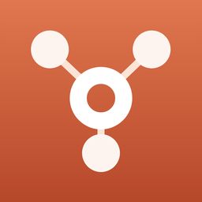

# EkipAI

**Turn your AIs into a team.**

A desktop app that puts Claude, ChatGPT, Gemini, DeepSeek and Kimi to work together as one team.

[**Download**](https://github.com/Ekip-Studio/EkipAI/releases) · Mac and Windows · Free beta · 16 languages

**English** · [Türkçe](README.tr.md)

---

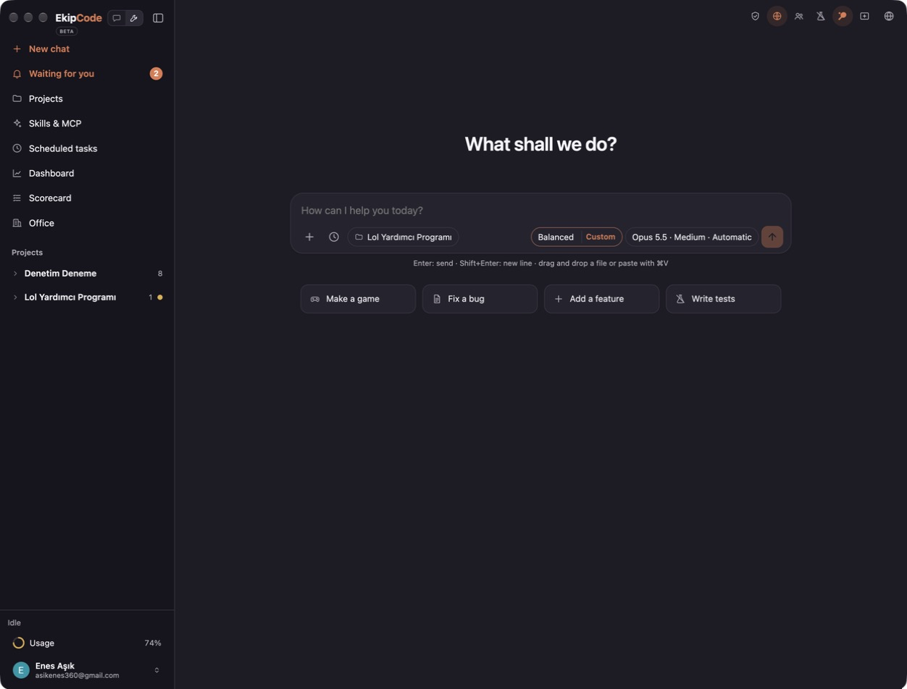

## How it works

You write what you want. EkipAI's **main agent** breaks the job into parts, hands each part to the AI on the team that fits it best, and checks the result. When one AI runs out of quota, another one takes over.

- **Chat and Task:** Ask a question or hand over a job. EkipAI builds the app, the game or the fix, tries it and shows it to you.
- **Projects:** Every project keeps its own memory, versions and tests, so you pick up where you left off.
- **Office:** Workers that check things for you on a schedule. They read your mail, gather the news and leave a short report.
- **Dashboard and Scorecard:** See at a glance which AI is good at what and how much quota you have left.
- **Skills and MCP:** Give the team new skills and tools.

### Up to four chats side by side

Split the window into two or four panes. Each pane runs its own chat with its own AI, and you can watch them all at once.

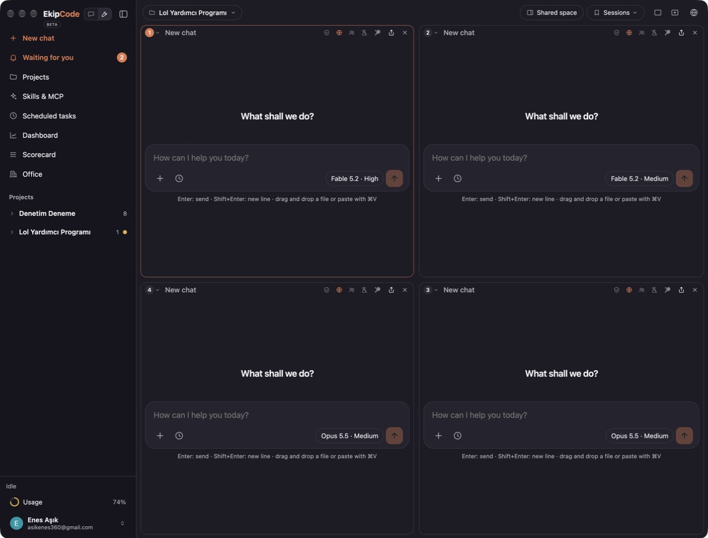

### Office

Add a ready-made worker, or describe what you need in your own words and EkipAI drafts the worker card.

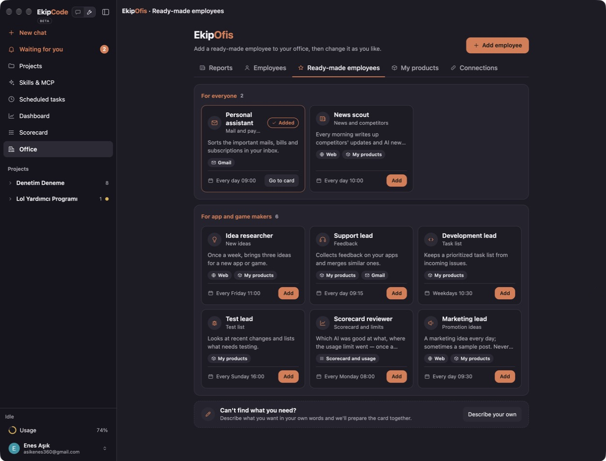

### Dashboard and Scorecard

Your quotas and usage at a glance. The scorecard keeps track of how well each AI does at each kind of job, and automatic task assignment uses it.

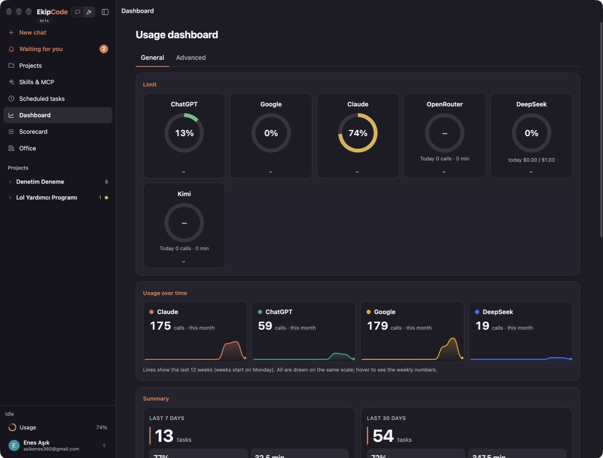

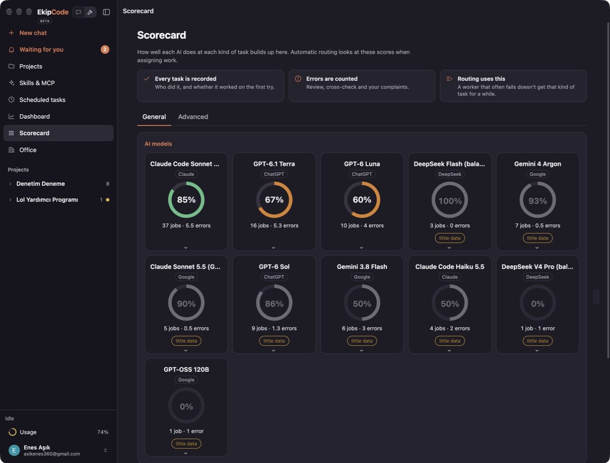

### Skills and MCP

Ready-made skill packs from Anthropic, Vercel, Google and others, all in one place.

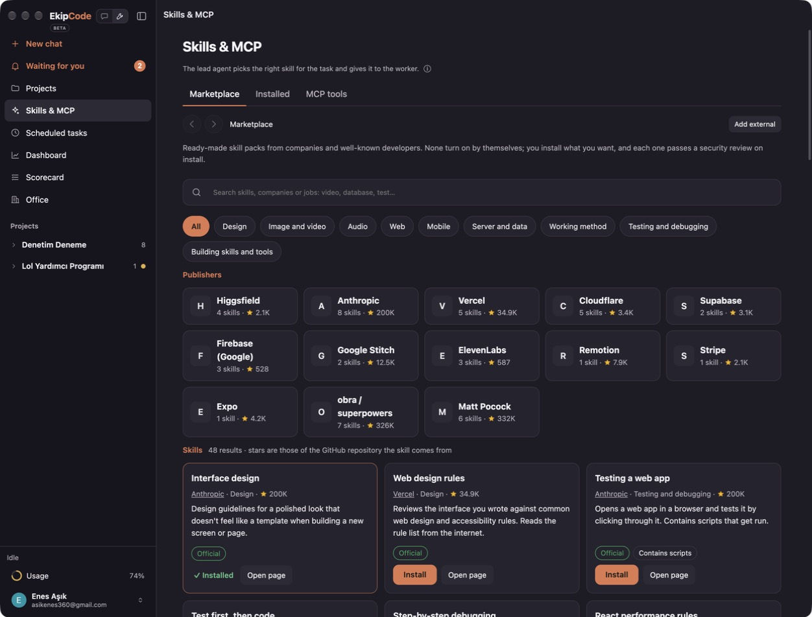

### Settings

You choose which AIs and tools get to work.

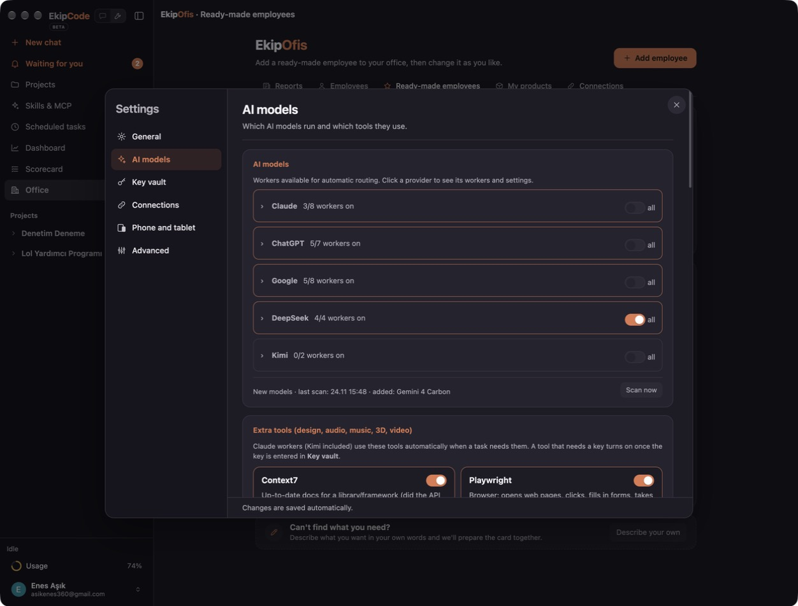

### Themes

Five colors in light and dark: White, Cream, Sky, Sage and Lavender. You can also make all text larger or smaller.

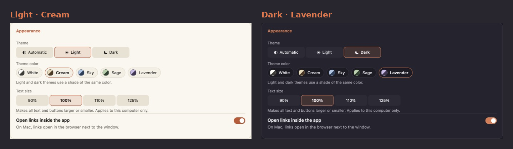

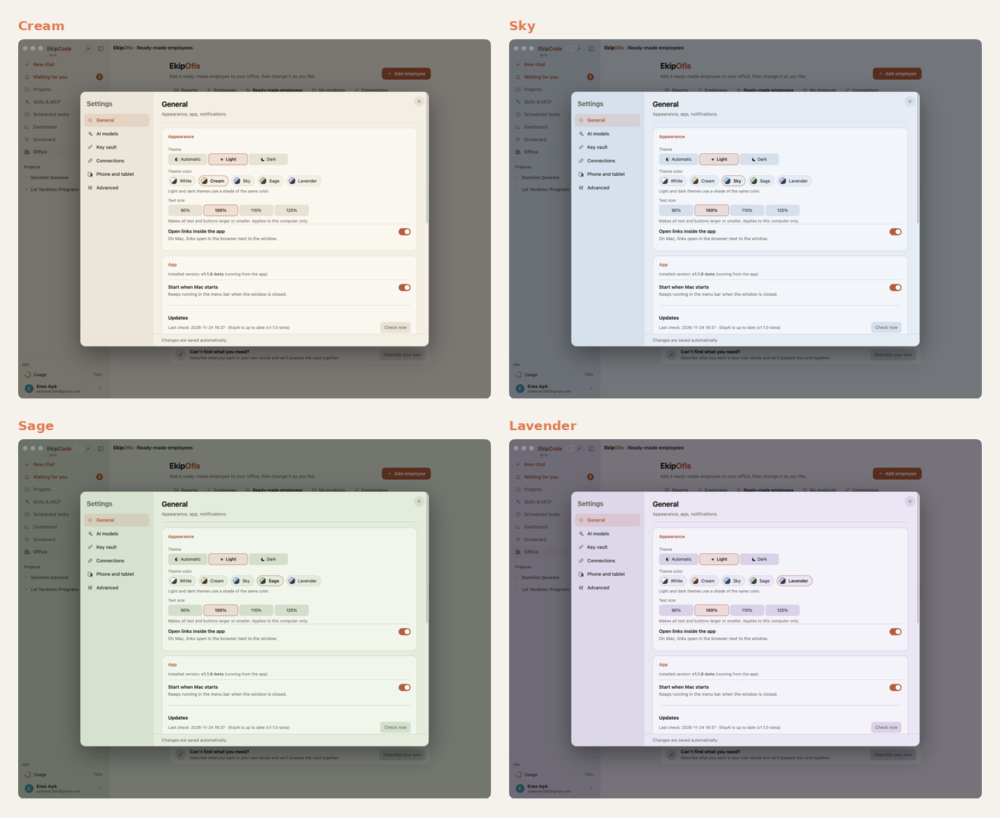

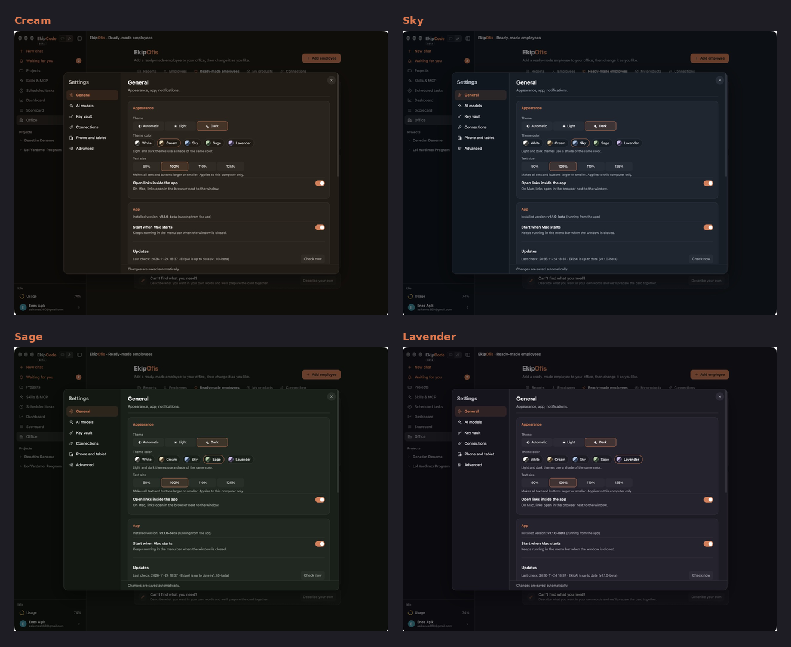

## Privacy

- Your conversations, projects and reports stay **on your computer**.
- The AIs work **with your own accounts**; EkipAI doesn't sit in between.
- Your API keys are kept in your computer's secure storage.
- Cloud sync is optional and end-to-end encrypted.

## Download and install

| | |
|---|---|
| **Mac** | Apple Silicon (M1 or later), macOS 13 or newer. Open the `.dmg` and drag EkipAI into Applications. |
| **Windows** | Windows 10/11, 64-bit. Open the `.exe` and follow the installer. If you see "Windows protected your PC", click **More info › Run anyway**. |

[**Download the latest version →**](https://github.com/Ekip-Studio/EkipAI/releases)

To use EkipAI you need at least one AI account: Claude, ChatGPT or Gemini. On first launch the app walks you through setup.

## Feedback

Found a problem or have an idea? In the app, use **account menu › Send feedback**, or write to asikenes360@gmail.com.

---

EkipAI is made by <a href="https://github.com/Ekip-Studio">Ekip Studio</a>. The source code is closed; this repository only hosts the release files.

