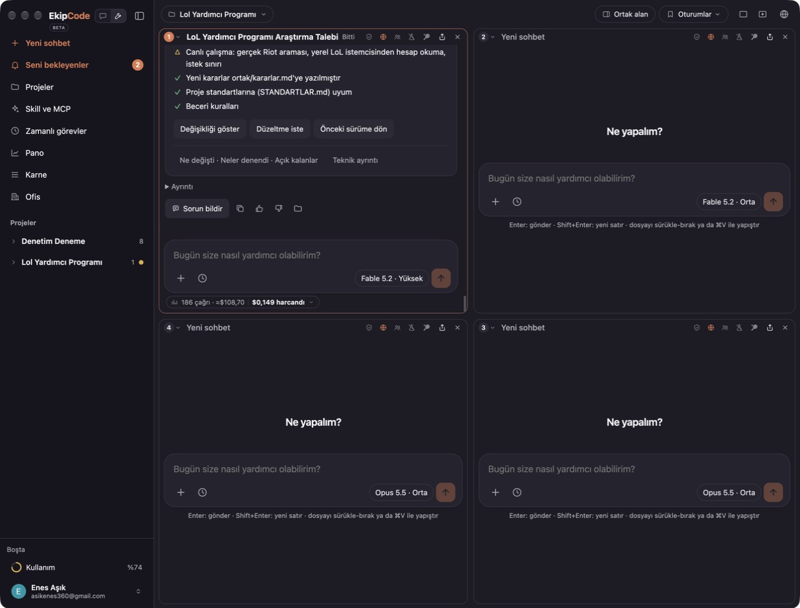
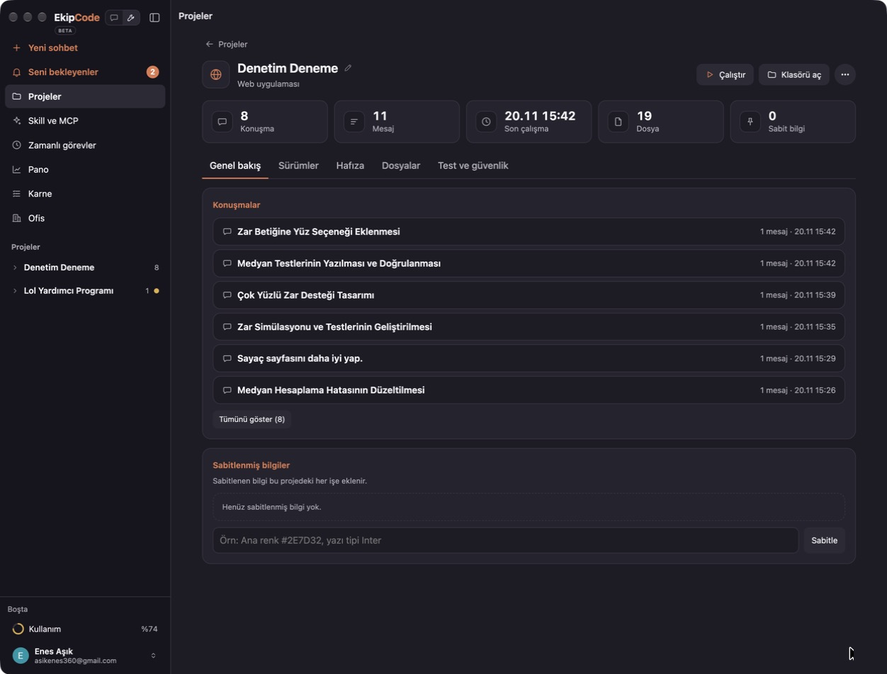
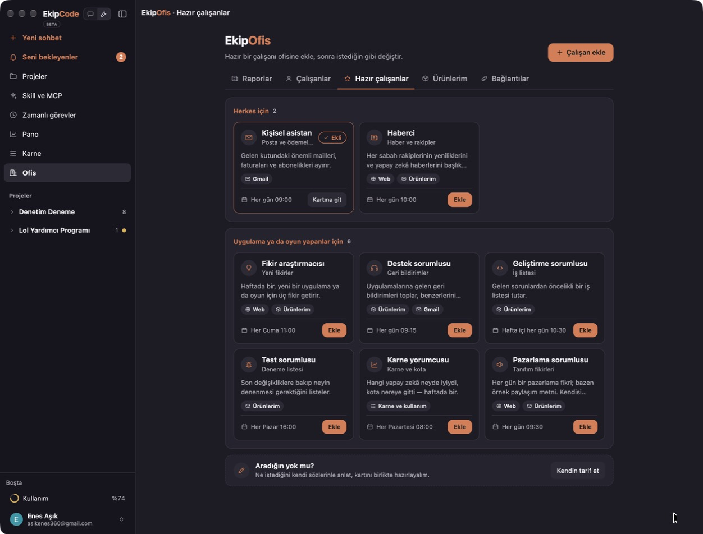
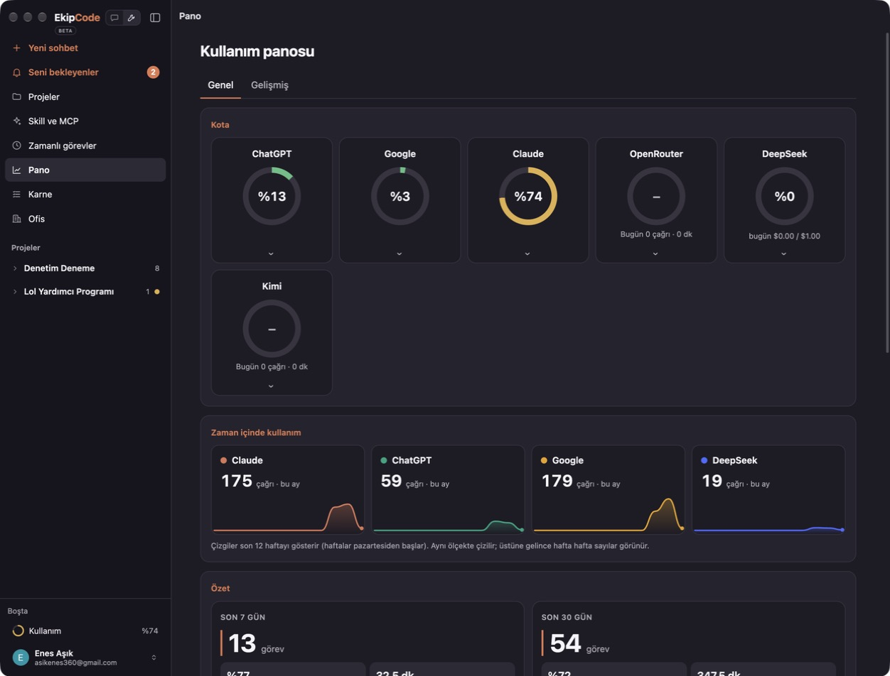
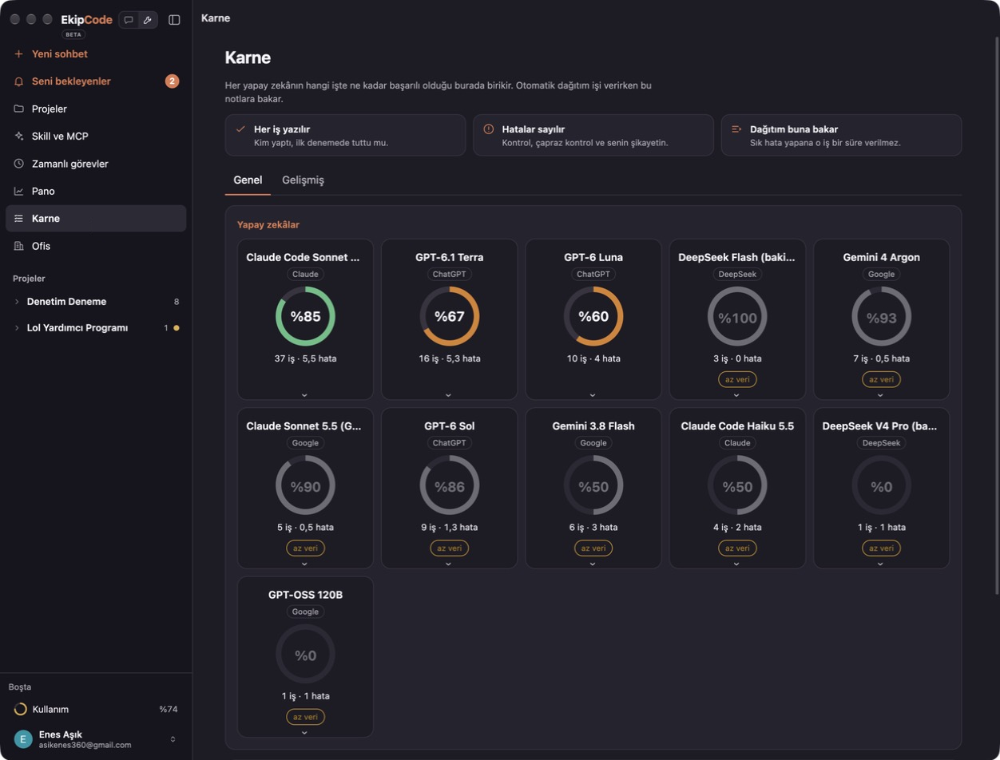
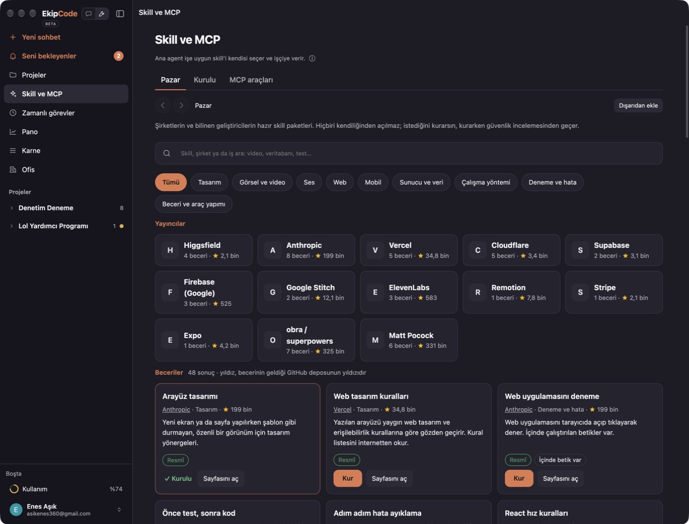
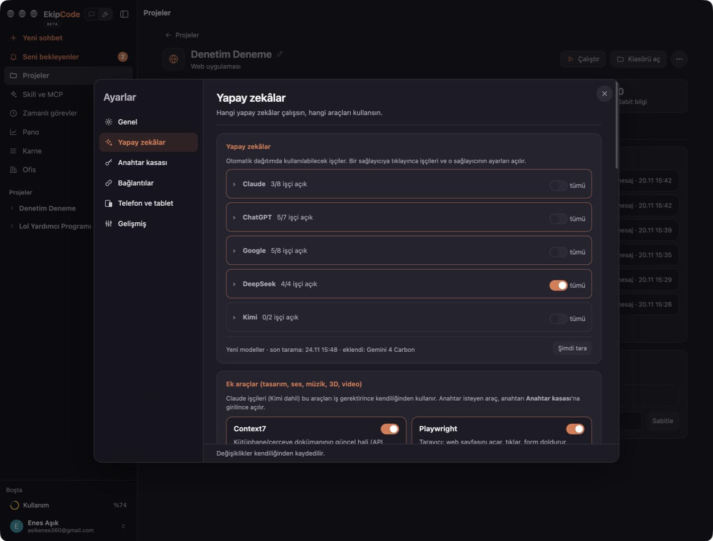
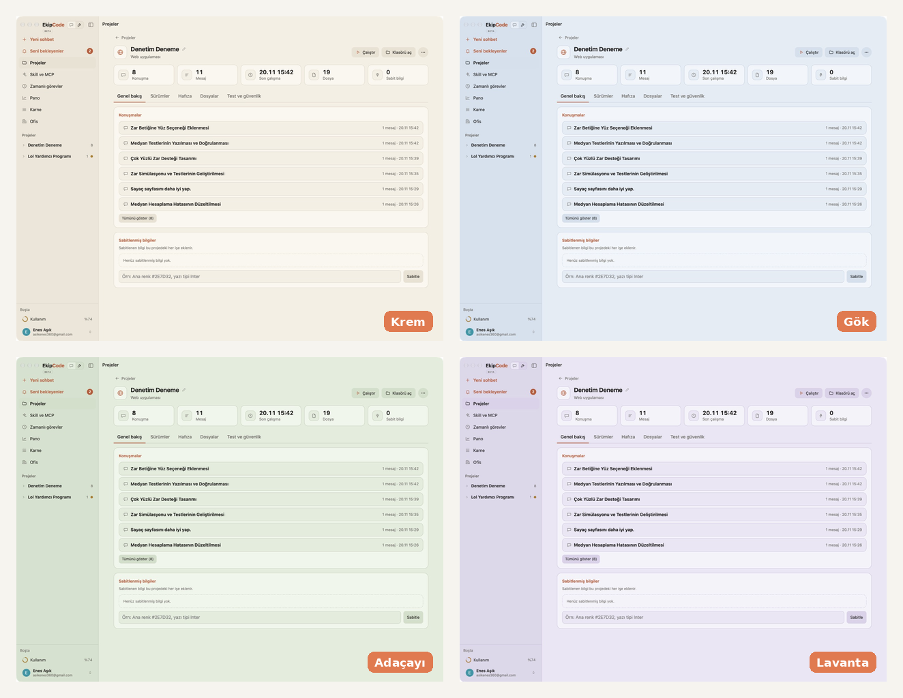
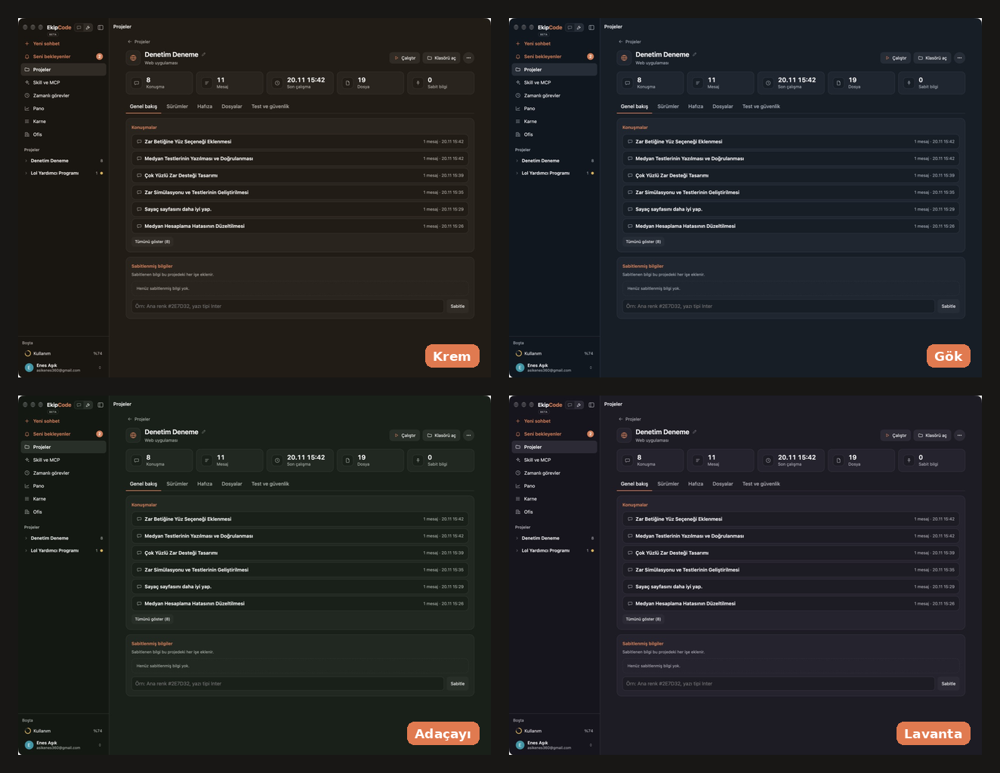

# EkipAI

**Yapay zekâlarından bir ekip kur.**

Claude, ChatGPT, Gemini, DeepSeek ve Kimi'yi tek bir ekipte çalıştıran masaüstü uygulaması.

[**İndir**](https://github.com/Ekip-Studio/EkipAI/releases) · Mac ve Windows · Ücretsiz beta

---

## Nasıl çalışır

Sen ne istediğini yazarsın. EkipAI'nin **ana agent**'ı işi parçalara böler, parçaları ekipteki yapay zekâlara dağıtır ve sonucu kontrol eder. Her yapay zekâ iyi olduğu işi yapar, kotası dolan yerine diğeri devreye girer.

- **Sohbet ve Görev:** Bir şey sor ya da iş ver. EkipAI uygulamayı, oyunu ya da düzeltmeyi yapar, dener ve sana gösterir.
- **Projeler:** Her projenin kendi hafızası, sürümleri ve testleri var. Kaldığın yerden devam edersin.
- **Ofis:** Senin yerine düzenli bakan çalışanlar. Postanı okur, haberleri toplar, kısa bir rapor bırakır.
- **Pano ve Karne:** Hangi yapay zekâ neyi ne kadar iyi yapıyor, kotan ne durumda, hepsi bir bakışta.
- **Skill ve MCP:** Ekibe yeni yetenekler ve araçlar ekle.

### Projeler

Her projenin kendi sayfası var: konuşmaları, sürümleri, hafızası, dosyaları ve testleri bir arada.

### Ofis

Hazır çalışanlardan birini ekle ya da ne istediğini kendi sözlerinle anlat; EkipAI çalışan kartını hazırlar.

### Pano ve Karne

Kotaların ve kullanımın bir bakışta. Karne, hangi yapay zekânın hangi işte ne kadar başarılı olduğunu tutar; otomatik dağıtım buna bakar.

### Skill ve MCP

Anthropic, Vercel, Google ve diğerlerinin hazır skill paketleri tek yerde.

### Ayarlar

Hangi yapay zekâların ve araçların çalışacağını sen seçersin.

### Temalar

Açık ve koyu temada beş renk: Beyaz, Krem, Gök, Adaçayı ve Lavanta.

## Gizlilik

- Konuşmaların, projelerin ve raporların **senin bilgisayarında** durur.
- Yapay zekâlar **senin kendi hesaplarınla** çalışır; EkipAI araya girmez.
- API anahtarların bilgisayarının güvenli deposunda tutulur.
- Bulut eşitleme isteğe bağlıdır ve uçtan uca şifrelidir.

## İndir ve kur

| | |
|---|---|
| **Mac** | Apple Silicon (M1 ve sonrası), macOS 13 ya da yenisi. `.dmg` dosyasını aç, EkipAI'yi Uygulamalar'a sürükle. |
| **Windows** | Windows 10/11, 64 bit. `.exe` dosyasını aç, kurulumu izle. "Windows bilgisayarınızı korudu" çıkarsa **Ek bilgi › Yine de çalıştır**. |

[**Son sürümü indir →**](https://github.com/Ekip-Studio/EkipAI/releases)

EkipAI'yi kullanmak için en az bir yapay zekâ hesabın olmalı: Claude, ChatGPT ya da Gemini. İlk açılışta uygulama seni adım adım yönlendirir.

## Geri bildirim

Bir sorun mu buldun, bir fikrin mi var? Uygulamada **hesap menüsü › Geri bildirim gönder**'i kullan ya da asikenes360@gmail.com adresine yaz.

---

EkipAI bir <a href="https://github.com/Ekip-Studio">Ekip Studio</a> uygulamasıdır. Kaynak kodu kapalıdır; bu depo yalnız sürüm dosyalarını barındırır.

